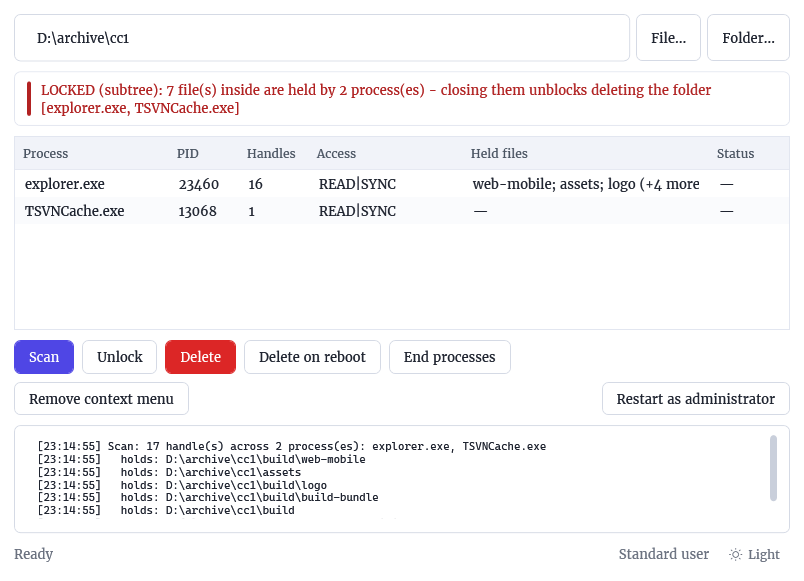
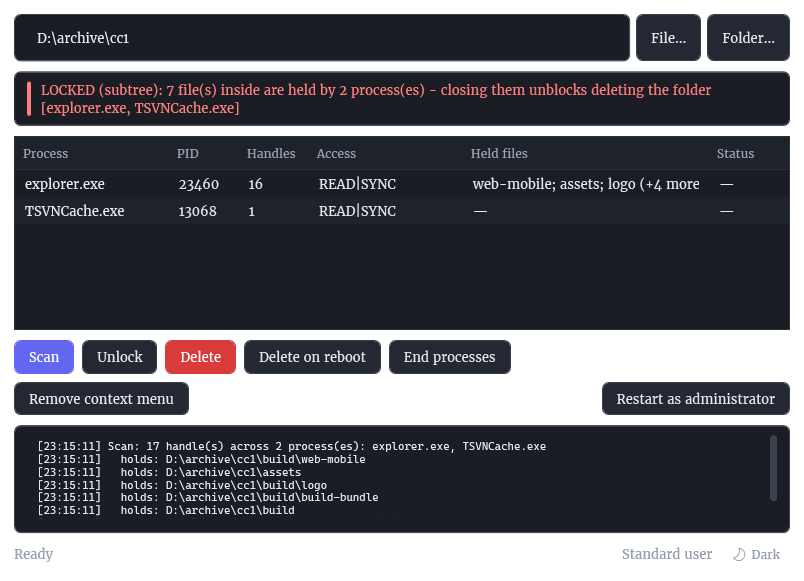

<p align="center">
  <a href="README.md">简体中文</a> · <a href="README.en.md"><b>English</b></a>
</p>

<p align="center">
  
</p>

<h1 align="center">UnlockKit</h1>

<p align="center">
  <b>Unlock and force-delete files that Windows won't let go.</b><br>
  Shows you exactly which process is holding a file, then gets rid of it — from a window, a CLI, or the right-click menu.
</p>

<p align="center">
  <a href="https://github.com/MikeKen-Ken/UnlockKit/actions/workflows/build.yml"></a>
  
  
  
</p>

---

<p align="center">
  
  
  <br>
  <sub>Light / dark — a real scan: <code>explorer.exe</code> and <code>TSVNCache.exe</code> holding 7 files inside <code>D:\archive\cc1</code></sub>
</p>

---

## The problem

You try to delete a folder and Windows says one of these:

> The action can't be completed because the folder or a file in it is open in another program
> Access is denied
> 另一个程序正在使用此文件，进程无法访问。

Most tools answer with a single button: **Unlock**. It fails, you reboot, and you still don't know what happened.

UnlockKit answers with a diagnosis first. It enumerates every open handle in the system, matches the ones that point at your target *by volume serial and file ID* (not by string comparison, so hardlinks and `\\?\` aliases can't fool it), and tells you which of the five possible causes you actually have. Only then does it act — with the cheapest technique that can work, never the most violent one.

## What it does

- **Names the holder.** Process name, PID, and every handle with its granted access. No more "some program".
- **Scans inside folders.** For a directory target it walks the whole subtree, because the folder itself is almost never the thing being held — a child file is, and a watcher (SVN/Git indexer, antivirus, sync client, Explorer thumbnailer) will re-open it milliseconds later.
- **Deletes with POSIX semantics**, which unlinks the name immediately even while other handles are open. Read-only attributes are ignored, since the flag is part of the same call.
- **Closes the blocking handles** when POSIX alone isn't enough — re-verifying each handle's identity immediately before closing it, so a recycled handle number can never hit an unrelated object.
- **Ends the process** as a last resort, and reports honestly when it can't (`PPL`, zombie, access denied).
- **Schedules the delete for next boot** through `PendingFileRenameOperations` when the lock genuinely can't be broken from user mode.
- **Right-click integration** — one `UnlockKit` entry with `Unlock` and `Delete` children, icons included, installed per-user so it never needs elevation.
- **Light and dark themes** — follows Windows on first run, one click in the bottom-right corner to switch, right-click that switch for *Follow Windows*. The choice is stored in `HKCU\Software\UnlockKit`, and the title bar goes dark too, so there is no white frame around a black window.

## Install

Grab `UnlockKit.exe` from [Releases](https://github.com/MikeKen-Ken/UnlockKit/releases) — a single self-contained file, no .NET runtime needed, ~68 MB.

Then either:

- **Run it directly.** It is portable; you can drag a file or folder onto the window or pass it as an argument.
- **Click `Install context menu`** in the window. This copies the executable to `%LOCALAPPDATA%\Programs\UnlockKit\UnlockKit.exe` and writes a per-user `HKCU` shell verb. Click the same button again (now `Remove context menu`) to undo it.

> **Windows 11 note:** this is a classic registry verb, so it appears under **Show more options** (or `Shift+F10`). Getting into the top-level menu requires an MSIX-packaged `IExplorerCommand` with app identity — that is a shell policy, not something a registry key can opt out of, and it isn't worth the packaging side effects for a utility like this.

> **Unsigned binary:** there is no code-signing certificate, so SmartScreen will say *"Windows protected your PC"* the first time you run it. *More info → Run anyway*, or build it yourself from the two commands at the bottom of this page.

## Quick start

```
1. Drop the stubborn file or folder on the window
2. Scan            -> "LOCKED (subtree): 5 file(s) inside are held by 1 process"
                      TSVNCache.exe  pid 8124
                        0x1234  READ|WRITE|DELETE
                        -> D:\archive\ccccc\assets\config.json
3. Unlock          -> closes those handles, the folder stays
4. Delete          -> gone
```

## CLI

The engine is also a standalone console app — `unlockkit-cli.exe`, same release page. Useful in scripts, build steps, and CI where a GUI is not.

```console
unlockkit-cli "D:\archive\ccccc"                  # diagnose only (default)
unlockkit-cli diagnose "D:\archive\ccccc"         # same, explicit
unlockkit-cli delete   "D:\archive\ccccc"         # delete now, POSIX semantics
unlockkit-cli delete   "D:\archive\ccccc" --reboot  # allow scheduling at next boot
unlockkit-cli close    "D:\archive\ccccc"         # close blocking handles, keep the file
unlockkit-cli kill     "D:\archive\ccccc"         # terminate the processes holding it
```

| Flag | Meaning |
| --- | --- |
| `--json` | Machine-readable output, one object per run |
| `-v`, `--verbose` | Print every handle's full object path |
| `--reboot` | Permit the `PendingFileRenameOperations` fallback |
| `-h`, `--help` | Usage text |

Exit codes are stable, so `if errorlevel` works:

| Code | Meaning |
| --- | --- |
| `0` | Success, or nothing was locked |
| `1` | Locked — action refused or failed |
| `2` | Usage error, or the path could not be inspected |

## How it decides

Diagnosis is a verdict, not a boolean. The verdict selects the action.

| Verdict | Meaning | What UnlockKit does |
| --- | --- | --- |
| `NOT LOCKED` | No user-mode handle holds it and `DELETE` is granted | Deletes normally |
| `LOCKED but deletable` | Handles exist, but they were opened with `FILE_SHARE_DELETE` | POSIX delete succeeds in one call — nothing is closed |
| `LOCKED` | Handles opened **without** share-delete | Closes those handles, then POSIX-deletes |
| `LOCKED (subtree)` | The folder is free but files inside it are held | Closes the subtree in one pass, deletes bottom-up |
| `ACL BLOCKS DELETE` | Nothing holds it; the account lacks the `DELETE` right | Refuses, tells you it's permissions — not a lock |
| `KERNEL-HELD LOCK` | `ERROR_SHARING_VIOLATION` with no closable handle | Refuses (or schedules for reboot, if you asked) |

That last row is the important one. When a filter driver holds the file, no user-mode tool can break it — not this one, not any other. UnlockKit says so instead of failing silently: one lock has exactly one cause, and pretending otherwise is how "unlockers" get their reputation.

## Honest limits

Roughly half of real-world delete failures are actually fixable from user mode. The rest are structural, and no amount of clicking will change that:

- **Kernel-held locks** — antivirus minifilters, backup agents, cloud sync providers holding a file in a filter driver. Nothing in user mode can close those. Reboot-delete is the only exit.
- **Mapped image sections** — you cannot delete a running `.exe` or a loaded `.dll`. `STATUS_CANNOT_DELETE`, and that's correct behaviour.
- **PPL processes** — `MsMpEng`, `services`, `lsass` and friends are protected; even `SeDebugPrivilege` cannot open them. UnlockKit refuses them by name and tells you the protection level.
- **Terminating processes** — a process stuck mid-termination keeps its handles until the kernel reaps it. Wait, or reboot.
- **ACLs** — a missing `DELETE` right is a permissions problem. UnlockKit diagnoses it precisely, but does not silently take ownership of your files behind your back.

Refusing to touch `System`, `csrss`, `wininit`, `winlogon`, `services`, `lsass` and the antimalware engine is deliberate, not a limitation to be fixed. Closing handles in those processes ranges from "the desktop stops responding" to "bugcheck".

## Build

Requirements: Windows 10/11 x64, [.NET 9 SDK](https://dotnet.microsoft.com/download).

```console
git clone https://github.com/MikeKen-Ken/UnlockKit.git
cd UnlockKit
dotnet build -c Release

# single-file GUI
dotnet publish src/UnlockKit.UI/UnlockKit.UI.csproj -c Release -r win-x64 ^
  --self-contained true -p:PublishSingleFile=true ^
  -p:IncludeNativeLibrariesForSelfExtract=true -p:EnableCompressionInSingleFile=true -o dist/gui

# single-file CLI
dotnet publish src/UnlockKit/UnlockKit.csproj -c Release -r win-x64 ^
  --self-contained true -p:PublishSingleFile=true ^
  -p:IncludeNativeLibrariesForSelfExtract=true -p:EnableCompressionInSingleFile=true -o dist/cli
```

CI does exactly this on every push, and attaches both binaries to a GitHub Release when a `v*` tag is pushed — see [`.github/workflows/build.yml`](.github/workflows/build.yml).

## Repository layout

```
src/
  UnlockKit/            engine + CLI — handle scanning, safety policy, delete ladder
    Native/             P/Invoke surface (ntdll, kernel32, advapi32)
    Core/               scanner, process probing, path mapping, safety policy
    Actions/            POSIX delete, handle closing, recursive tree delete
  UnlockKit.UI/         WPF front end, per-user shell integration, self-installer
    Themes/             light and dark colour dictionaries, plus every control style
docs/
  DESIGN.md             design notes (Chinese)
  DESIGN.en.md          design notes (English)
  TROUBLESHOOTING.md    failure taxonomy (Chinese)
  TROUBLESHOOTING.en.md failure taxonomy (English)
assets/                 icon and screenshot sources
```

## Documentation

Both docs exist in both languages:

- **[docs/DESIGN.en.md](docs/DESIGN.en.md)** — the handle scanner, identity matching, the delete ladder, and the TOCTOU trade-offs.
- **[docs/TROUBLESHOOTING.en.md](docs/TROUBLESHOOTING.en.md)** — "I still can't delete it." Organised by the error you're seeing.

Chinese versions: [DESIGN.md](docs/DESIGN.md) / [TROUBLESHOOTING.md](docs/TROUBLESHOOTING.md). The [Chinese README](README.md) covers the same ground as this page.

## License

[MIT](LICENSE). Do whatever you want; no warranty, and it will happily delete the wrong thing if you point it at the wrong path.
